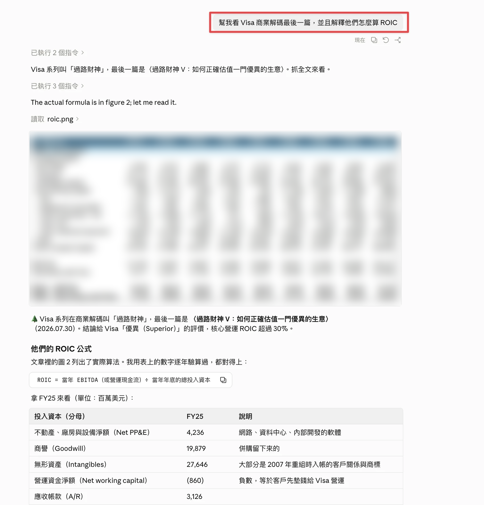
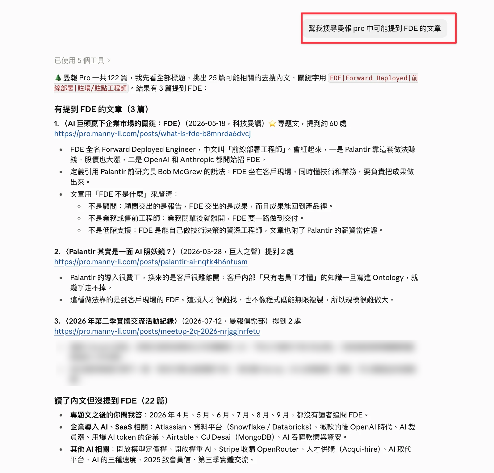
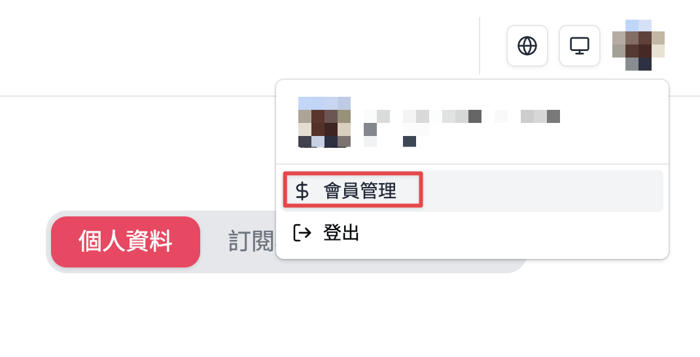
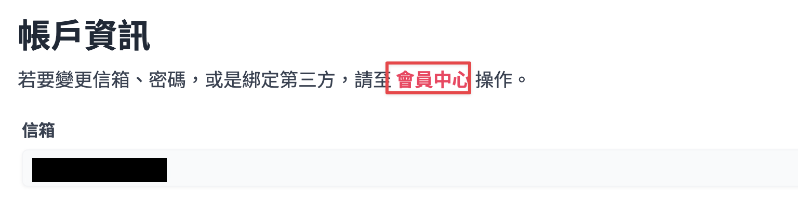
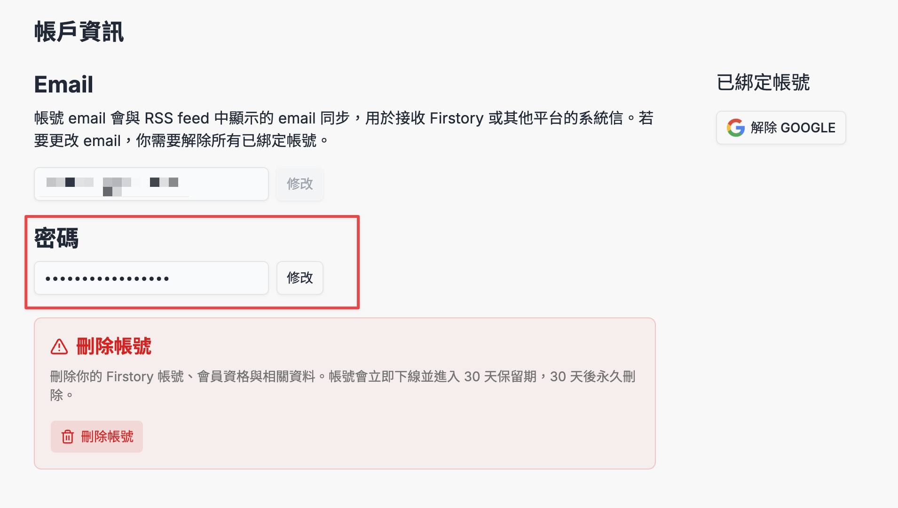

# mannypro-mcp

讓 Claude Code、Codex 等 AI agent 直接讀《曼報 Pro》（[pro.manny-li.com](https://pro.manny-li.com)）會員文章的 MCP server。

可以列文章、依分類篩選、搜尋標題，並把整篇文章（含小標、連結、圖表與圖說）轉成 Markdown。

> [!IMPORTANT]
> **⚠️ 你需要自己有《曼報 Pro》的付費會員帳號才能讀全文。**
>
> 這個工具只是用**你自己的帳號**登入後代為讀取，不會繞過付費牆，也不附帶任何帳號。
>
> **請只供個人閱讀、整理筆記使用，不要轉載或散布付費內容。**
>
> 👉 還不是會員？**[訂閱《曼報 Pro》](https://pro.manny-li.com/join)**，支持作者持續產出深度內容。

## 👀 使用範例

裝好之後，直接用中文問 Claude Code / Codex 就可以。

**範例一：讀一篇文章並解釋**——「幫我看 Visa 商業解碼最後一篇，並且解釋他們怎麼算 ROIC」

AI 會自己找到 Visa 系列（標題叫「過路財神」）的最後一篇，讀完全文和文中圖表，再把 ROIC 的算法拆給你看：



（截圖中原文付費圖表的數字已模糊處理。）

**範例二：找出談到某個主題的文章**——「幫我搜尋曼報 pro 中可能提到 FDE 的文章」

AI 先看完 122 篇標題，挑出 25 篇可能相關的去讀內文，最後回報 3 篇真的有談到 FDE（附重點與連結），也列出讀了但沒提到的 22 篇：



（截圖中會員交流活動的會員發言已模糊處理。）

---

## 📌 第 0 步：先準備好你的曼報 Pro 帳密（必做）

這個工具**不附帶任何帳號**，要用你自己的《曼報 Pro》會員帳號登入，而且只支援「**Email＋密碼**」登入。不管你等一下是交給 AI 安裝還是自己手動裝，都要先準備好這組帳密。

- **已經用 Email＋密碼登入曼報 Pro 的人**：記下這組帳密，直接看下一段。
- **平常用 Google / Apple / Facebook 登入的人**：你的帳號預設**沒有密碼**，請照下面 3 個步驟先設一組（大約 1 分鐘）：

1. 登入 [pro.manny-li.com](https://pro.manny-li.com)，點右上角頭像 →「**會員管理**」

   

2. 在「帳戶資訊」頁點「**會員中心**」連結（信箱、密碼、第三方綁定都在 Firstory 會員中心管理）

   

3. 在 Firstory 的「帳戶資訊」頁，「**密碼**」欄位按「**修改**」設定密碼

   

   - **Email** 就是這一頁上方 Email 欄位顯示的信箱
   - 設好密碼後 Google 等綁定帳號照常能用，不需要解除綁定
   - 可以到 [open.firstory.fm/login](https://open.firstory.fm/login) 用「Email＋密碼」登入一次，確認這組帳密可用

---

## 🚀 最簡單的安裝方式：交給 AI 幫你裝（不用懂程式）

如果你已經有 [Claude Code](https://claude.com/claude-code) 或 [Codex](https://developers.openai.com/codex)，不用自己打任何指令，請 AI 照這份說明幫你裝好。

**開始前：** 確認你已經完成上面的「第 0 步」，手邊有曼報 Pro 的 Email＋密碼，等一下 AI 會問你。

**接著三步：**

1. 打開終端機（Mac：按 `⌘ + 空白鍵`，輸入「終端機」或「Terminal」後按 Enter），輸入 `claude` 按 Enter 開啟 Claude Code（用 Codex 的人輸入 `codex`）。

2. 把下面這段**整段複製**，貼進去按 Enter：

   ```text
   幫我安裝這個 MCP server：https://github.com/nissenyeh/mannypro-mcp
   請把 repo clone 到 ~/mannypro-mcp，讀 README，照最後面「給 AI agent 的安裝步驟」一步一步做完。
   需要我的曼報 Pro 帳密時再問我；裝好後幫我測試能不能讀到全文。
   ```

3. 過程中 AI 會：
   - 請你允許它執行指令 → 選「Yes」或「允許」
   - 問你曼報 Pro 的 **Email 和密碼** → 直接回覆它
   - 最後回報「可以讀全文」就代表成功了

**裝好之後：** 把 Claude Code / Codex 關掉重開（輸入 `/exit` 再重新輸入 `claude`），就可以直接用中文叫它讀曼報，例如：

- 「列出曼報最新 10 篇文章」
- 「抓曼報〈名利雙收 I〉全文，整理成重點筆記」

> 💡 帳密只會存在你自己電腦的 `~/.config/mannypro-mcp/credentials.env`，不會上傳到 GitHub。不想把密碼打給 AI 的話，可以請它「建好帳密檔就好，我自己填」，再自己打開那個檔案填入。

想自己一步步手動安裝的人，請看下面的完整說明。

---

## 工具

| 工具 | 用途 | 需要登入 |
|---|---|---|
| `list_tags` | 列分類（商業解碼、科技曼讀、巨人之聲、曼報俱樂部） | 否 |
| `list_articles(tag, limit, cursor, oldest_first)` | 列文章，可依分類篩選、翻頁 | 否 |
| `list_all_titles` | 一次列出全部文章的日期、分類、標題、slug | 否 |
| `search_articles(keyword)` | 用關鍵字比對標題／副標／分類／網址（不搜內文） | 否 |
| `grep_articles(articles, pattern)` | 只讀指定幾篇的全文，列出符合關鍵字的段落 | 是（自動） |
| `get_article(article)` | 抓全文轉 Markdown；`article` 可以是網址、slug 或標題關鍵字 | 是（自動登入） |
| `login_status` | 檢查帳密能不能登入、能不能讀到全文 | 是 |

---

## 1. 前置作業

### 1-1 安裝 uv

這個 server 用 Python 寫，透過 [uv](https://docs.astral.sh/uv/) 執行，套件會自動安裝。

```bash
# macOS / Linux
curl -LsSf https://astral.sh/uv/install.sh | sh
# 或 macOS：brew install uv
```

### 1-2 下載這個 repo

```bash
git clone https://github.com/nissenyeh/mannypro-mcp.git ~/mannypro-mcp
cd ~/mannypro-mcp
uv sync
```

後面的設定會用到這個資料夾的**絕對路徑**，用 `pwd` 查一下，例如 `/Users/you/mannypro-mcp`。

### 1-3 寫入你的帳密（必做）

先確認你已經照最上面的「[第 0 步](#-第-0-步先準備好你的曼報-pro-帳密必做)」準備好 Email＋密碼，再把它存到電腦上：

兩種方式擇一：

**方式 A：帳密檔（推薦）**——帳密只存在你自己的電腦，不會出現在 agent 的設定檔裡。

```bash
mkdir -p ~/.config/mannypro-mcp
cat > ~/.config/mannypro-mcp/credentials.env <<'EOF'
MANNYPRO_EMAIL=you@example.com
MANNYPRO_PASSWORD=你的密碼
EOF
chmod 600 ~/.config/mannypro-mcp/credentials.env
```

**方式 B：環境變數**——在下面註冊 MCP 時用 `MANNYPRO_EMAIL`、`MANNYPRO_PASSWORD` 帶進去（範例見各 agent 的說明）。

登入成功後，session cookie 會存在 `~/.config/mannypro-mcp/cookies.json`（權限 600），過期時會自動用帳密重新登入。

先在終端機測一下帳密對不對：

```bash
uv --directory ~/mannypro-mcp run python -c \
  "from mannypro_mcp.server import login_status; print(login_status())"
# 成功會看到：已用 you@example.com 重新登入。可以讀全文：《…》正文 xxxx 字。
```

---

## 2. 在 Claude Code 使用

用 `claude mcp add` 註冊（把路徑換成你的）：

```bash
# 用帳密檔（方式 A）
claude mcp add --scope user mannypro -- \
  uv --directory /Users/you/mannypro-mcp run mannypro-mcp

# 或用環境變數（方式 B）
claude mcp add --scope user mannypro \
  -e MANNYPRO_EMAIL=you@example.com -e MANNYPRO_PASSWORD=你的密碼 -- \
  uv --directory /Users/you/mannypro-mcp run mannypro-mcp
```

- `--scope user`：所有專案都能用；拿掉就只在目前專案生效。
- 確認狀態：`claude mcp list` 應該看到 `mannypro: ... ✔ Connected`。
- 要**開新的 Claude Code session** 工具才會出現；在 session 裡輸入 `/mcp` 可以看到 `mannypro` 和它的工具。

---

## 3. 在 Codex 使用

用 `codex mcp add` 註冊：

```bash
# 用帳密檔（方式 A）
codex mcp add mannypro -- uv --directory /Users/you/mannypro-mcp run mannypro-mcp

# 或用環境變數（方式 B）
codex mcp add mannypro \
  --env MANNYPRO_EMAIL=you@example.com --env MANNYPRO_PASSWORD=你的密碼 -- \
  uv --directory /Users/you/mannypro-mcp run mannypro-mcp
```

或直接編輯 `~/.codex/config.toml`：

```toml
[mcp_servers.mannypro]
command = "uv"
args = ["--directory", "/Users/you/mannypro-mcp", "run", "mannypro-mcp"]
# 用方式 B 才需要下面這行
# env = { MANNYPRO_EMAIL = "you@example.com", MANNYPRO_PASSWORD = "你的密碼" }
```

- 確認狀態：`codex mcp list`。
- 重新開 Codex（CLI 或 IDE 擴充）後，在對話裡輸入 `/mcp` 可以看到 `mannypro`。

---

## 4. 怎麼用

直接用自然語言跟 agent 說，例如：

- 「列出曼報最新 10 篇文章」
- 「曼報有哪些分類？列出巨人之聲最近 5 篇」
- 「搜尋曼報講 Stripe 的文章」
- 「抓曼報〈名利雙收 I〉全文，整理成重點筆記」
- 「把商業解碼『因貨得福』系列 I–IV 全部抓下來，合成一份 Markdown」
- 「幫我看 Visa 商業解碼最後一篇，並且解釋他們怎麼算 ROIC」

### 找「哪些文章談到某個主題」

網站沒有全文搜尋 API，而且很多文章標題不會直接寫關鍵字（例如 Visa 系列叫「過路財神」）。所以 server 內建的使用說明會請 AI 照這個流程做，不會一次把全部文章抓下來：

1. `list_all_titles` 拉全部標題
2. 依標題判斷哪些可能相關（例如找 FDE，也會想到 Palantir、企業導入 AI 的文章）
3. `grep_articles` 只讀這幾篇候選文章的全文，找關鍵字
4. 回報：真的有談到的文章＋摘錄、讀了但沒提到的、哪些只看過標題

實際畫面請看最上面的「[使用範例](#-使用範例)」。

`get_article` 回傳的格式：

```markdown
# 名利雙收 I：別人出錢出力的高利潤生意

- 原文：https://pro.manny-li.com/posts/...
- 發布日期：2026.09.25
- 分類：商業解碼


...正文...


*圖 1：Springer Nature 各業務營收結構（FY2023-FY2025）。*

## 收稿：研究者主動送上門的稿源
...
```

圖片保留原始網址，沒有下載到本機。

---

## 疑難排解

| 狀況 | 原因／解法 |
|---|---|
| `找不到帳密` | 沒做 1-3；檢查 `~/.config/mannypro-mcp/credentials.env` 或環境變數 |
| `Firstory 登入失敗：user_not_found` | Email 打錯，或這個 Email 沒有 Firstory 帳號 |
| 其他 `Firstory 登入失敗：…` | 多半是密碼錯；用 Google 等社群帳號登入的人要先照最上面「第 0 步」設密碼 |
| `仍是付費牆畫面` | 帳號登入成功但沒有《曼報 Pro》會員資格（或會員已過期） |
| 想強制重新登入 | 刪掉 `~/.config/mannypro-mcp/cookies.json` |
| agent 裡看不到工具 | 註冊後要開新 session；`claude mcp list` / `codex mcp list` 看是否 Connected |

---

## 運作原理

1. `POST open.firstory.fm/api/auth/login/email` 用帳密取得 Firstory session
2. `GET open.firstory.fm/auth/sso/authorize`（PKCE S256，client_id `firstory.io`）→ 導回 `pro.manny-li.com/sso-callback?code=…`
3. `POST pro.manny-li.com/auth/sso/callback {code, state, code_verifier}` → 取得網站 session cookie
4. 文章列表走公開的 `prod-api.firstory.me/hosting/v1/graphql`（`playerPostConnection`）
5. 全文從登入後的文章頁 HTML 解析，用 [markdownify](https://github.com/matthewwithanm/python-markdownify) 轉成 Markdown

網站改版時解析可能會壞，歡迎開 issue。

---

## 給 AI agent 的安裝步驟

> 這一段是寫給 Claude Code / Codex 等 AI agent 看的：使用者請你安裝時，依序執行，每一步確認成功再進下一步。使用者多半不熟指令，請用白話跟他說明進度。

1. **確認 uv**：執行 `uv --version`。沒有的話執行 `curl -LsSf https://astral.sh/uv/install.sh | sh`，然後用 `~/.local/bin/uv` 或重新載入 shell 後的 `uv`。
2. **取得程式**：若 `~/mannypro-mcp` 不存在，`git clone https://github.com/nissenyeh/mannypro-mcp.git ~/mannypro-mcp`；已存在就 `git -C ~/mannypro-mcp pull`。接著 `uv --directory ~/mannypro-mcp sync`。
3. **帳密**：
   - 問使用者曼報 Pro（Firstory）的登入 Email 與密碼。如果他說平常用 Google 等社群帳號登入、沒有密碼，請他照 README 最上面「第 0 步」的截圖先設定密碼。
   - 寫入 `~/.config/mannypro-mcp/credentials.env`（內容兩行：`MANNYPRO_EMAIL=...`、`MANNYPRO_PASSWORD=...`），資料夾權限 700、檔案權限 600。
   - 如果使用者想自己填，就建立兩個值留空的檔案，告訴他檔案路徑，等他說填好再繼續。
   - 不要把帳密寫進 repo、MCP 設定檔或任何其他地方。
4. **測試登入**：執行
   `uv --directory ~/mannypro-mcp run python -c "from mannypro_mcp.server import login_status; print(login_status())"`
   - 看到「可以讀全文」才算成功。
   - 失敗時對照 README 的「疑難排解」，用白話告訴使用者該怎麼修（例如密碼打錯、帳號沒有會員資格）。
5. **註冊 MCP**（用絕對路徑，`~` 先展開成實際家目錄）：
   - Claude Code：`claude mcp add --scope user mannypro -- uv --directory <家目錄>/mannypro-mcp run mannypro-mcp`，再用 `claude mcp list` 確認 `mannypro` 顯示 Connected。
   - Codex：`codex mcp add mannypro -- uv --directory <家目錄>/mannypro-mcp run mannypro-mcp`，再用 `codex mcp list` 確認。
   - 如果 `uv` 不在 PATH（例如剛安裝），command 改用 uv 的絕對路徑（`which uv` 或 `~/.local/bin/uv`）。
6. **告訴使用者**：已經裝好；需要**關掉並重新開啟** Claude Code / Codex 才會出現 mannypro 工具；附上兩三句可以直接說的範例（如「列出曼報最新 10 篇文章」）。
